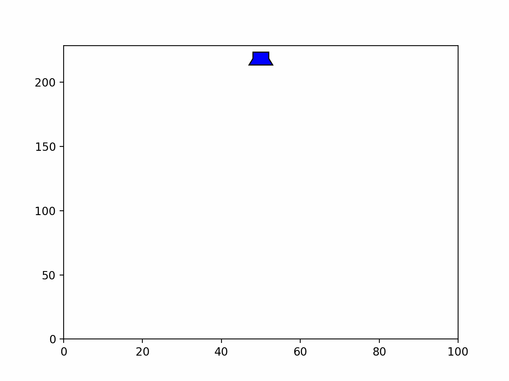
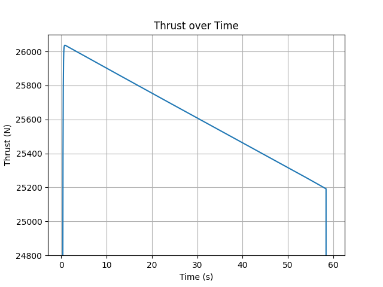
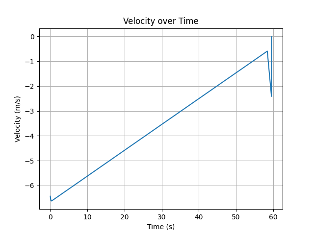

# Lunar Lander Simulator (Apollo 11)
-

A physics based simulation, that models the lunar module of apollo 11's descent, currently I use the altitude 213 meters, and -6.4m/s velocity for its initial values but this can be changed accordingly and the lander will continue to work as long as the numbers are within 700ft to 100ft. I worked through some of the derivations of it from the NASA site.

## What it does
  - Starts the lander at 213.4 meters, -6.4 m/s velocity numbers gotten from Buzz aldrins call out
  - Uses a guidance system to slow the aircraft down to a safe landing
  - Cuts the engine when altitude is less than 1.7 and the speed is safe to do so letting the craft free fall to simulate how apollo 11 landed their craft
  - Checks if landing was safe and animates the landing

## How it Works
  - Thrust was calculated in the spaceship.py using specific impulse(311) multiplies by earths gravity 9.80665 (because ISP was calculated on earths surface) multiplied by the mass flow rate.
  - Changing mass the main problem faced when solving how to land the craft is the changing mass of the rocket since the rocket kept getting lighter because the fuel kept flowing out it caused changes in the amount of thrust needed to maintain a safe descent
  - Eulers method, updates the velocity and altitude using a dt of 0.02

## Guidance
  I used the kinematic equation V^2 = V0^2 + 2aΔx to figure out the new acceleration needed because Vf was 0, and V0 and Δx was something I knew. I got a = v^2/2Δx which then I used to figure out what the thrust would need to be as ma = Fthrust +Fgravity which is just Fthrust = ma+Fgravity as Fgravity was negative. Since according this formula the decceleration needs to be constant the entire way down it served as a check for me to determine if the simulation worked as I expected.
  This was especially useful because of the amount of values the code spewed out plus calculating every step would be inefficient so this was a very useful check.

## Engine Cutoff
  The real lunar module also cut off at altitude 1.7 meters to ensure the safety of the craft and land safely. These numbers were thing I copied and I also added a velocity cutoff of -1m/s and lets the code run a free fall system.

## Checking For Safety of the Lunar Lander
  I used a metric that if the lunar lander had fallen at a rate of greater than 3.05 m/s it would be considered a crash landing.

## Code Structure
  - Lunar_Environment.py - has the lunar gravity
  - Spaceship.py - contains the landers mass, engine values, flight values, and thrust/acceleration calculations
  - guidance.py - runs the simulation, guidance logic, free fall, safety check, and stores data that later is used in the animation
  - simulation.py - creates the simulation and saves the gif

## How to install
  pip install -r requirements.txt
  python simulation.py

## Limitations
  - Doesnt contain horizontal motion
  - Assumes that the engine can instantly changes the thrust
  - Constant Lunar gravity (doesnt account for mascons)
  - No Max thrust limit
  - Lunar lander not drawn to scale in the animation

## Things to work on
  - Add more plots
  - Look into horizontal motion as well
  - Add mascons
  - Experiment with different control systems
  - Experiment with different landing manuevers (suicide burn)

## Results
  -
  -

## Sources
  - Apollo 11 landing transcript: nasa.gov
  - Apollo Lunar Module landing gear report, W. F. Rogers, NASA: nasa.gov
  - Guide to Rockets, NASA Glenn Research Center: [grc.nasa.gov](https://www1.grc.nasa.gov/beginners-guide-to-aeronautics/guide-to-rockets/)
